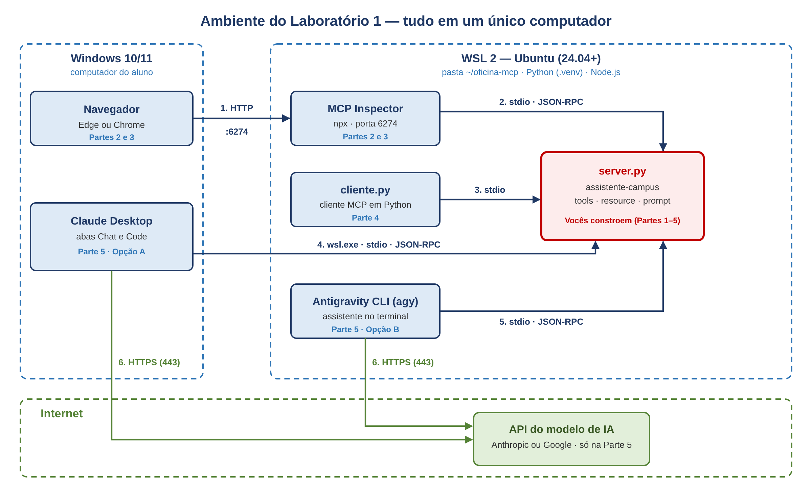

# Laboratório 1 — Meu Primeiro Servidor MCP

<p align="center">
  <br>
  <a href="https://github.com/lfserique/meu-mcp">github.com/lfserique/meu-mcp</a>
</p>

**Faculdade de Tecnologia e Inovação Senac DF** · Roteiro de Atividade Prática de Laboratório · *Oficina MCP: a porta USB da IA*

Prof. Luiz Fernando Sirotheau Serique Junior

## 1. Objetivos de Aprendizagem

Ao concluir este laboratório, vocês serão capazes de:

1. **Preparar** um ambiente de desenvolvimento Linux no Windows com WSL, Python e Node.js.
2. **Implementar** um servidor MCP em Python que expõe tools, resources e prompts.
3. **Testar** o servidor com o MCP Inspector, acompanhando as mensagens JSON-RPC trocadas.
4. **Construir** um cliente MCP mínimo que descobre e executa ferramentas sem depender de um modelo de IA.
5. **Integrar** o servidor a um assistente de IA de linha de comando e observar o modelo escolhendo as ferramentas.
6. **Reconhecer** riscos de segurança de servidores MCP, como prompt injection e excesso de permissões.

### Ambiente e topologia do laboratório

Todo o laboratório acontece em um único computador com Windows. Dentro dele, vocês vão instalar o **WSL 2 com Ubuntu** (24.04 ou mais recente), um Linux completo que roda junto com o Windows. É no Ubuntu que ficam o Python, o Node.js, o servidor MCP que vocês vão construir (`server.py`) e as ferramentas que conversam com ele. O Windows entra com o PowerShell, para instalar o WSL, com o navegador, para abrir a interface do MCP Inspector, e com o Claude Desktop, na Parte 5. A internet só é necessária para baixar pacotes e, na Parte 5, para o assistente de IA consultar o modelo na nuvem.

| Host | Função no laboratório | IP de exemplo | IP real (anote) |
| --- | --- | --- | --- |
| Windows 10 (2004+) ou 11 | Navegador para o MCP Inspector; PowerShell para instalar o WSL; Claude Desktop (Parte 5) | 127.0.0.1 |  |
| Ubuntu no WSL 2 | Python 3.12+ (.venv), Node.js LTS, `server.py`, `cliente.py`, Inspector, Antigravity CLI (`agy`) | 172.24.80.2 |  |
| API do modelo de IA | Anthropic (Claude Desktop) ou Google (Antigravity CLI), usada só na Parte 5 | Internet (HTTPS 443) | — |

Para descobrir o IP real do Ubuntu, rodem `hostname -I` no terminal do WSL. Não é preciso configurar nenhum IP: o WSL 2 encaminha os endereços `localhost` do Linux para o Windows automaticamente.



*Figura 1 — As setas numeradas mostram a ordem dos fluxos: 1) o navegador abre o Inspector; 2 a 5) Inspector, cliente.py, Claude Desktop (pelo wsl.exe) e agy iniciam o server.py via stdio; 6) os assistentes consultam o modelo na nuvem. Em vermelho, o servidor que vocês constroem. O IP do Ubuntu é de exemplo.*

**Pré-requisitos:** noções básicas de Python e de terminal Linux; nenhum laboratório anterior. **Software:** WSL 2, Python 3.12 ou superior (testado também com 3.14), SDK oficial `mcp` 2.x (testado nas versões 2.2 e 2.3), Node.js LTS via nvm e, opcionalmente, Claude Desktop para Windows (a aba Code exige plano Claude Pro ou superior) ou Antigravity CLI (conta Google) para a Parte 5.

## 2. Fundamentação Teórica

### O que é o MCP

Um modelo de linguagem, sozinho, só produz texto: ele não lê seus arquivos, não consulta bancos de dados nem aciona sistemas. Antes do MCP, cada aplicação de IA criava uma integração própria para cada sistema, o que gerava o problema N × M: N aplicações vezes M ferramentas, cada combinação escrita à mão.

O **Model Context Protocol (MCP)** é um protocolo aberto, lançado pela Anthropic em 2024 e hoje adotado por vários fornecedores, que padroniza essa conexão. Assim como a porta USB permite ligar qualquer dispositivo a qualquer computador, um servidor MCP escrito uma vez funciona em qualquer aplicação de IA compatível. E o ponto central: **o modelo nunca executa nada sozinho.** Ele apenas pede; quem executa é o servidor, sob controle da aplicação host.

### Principais conceitos

- **Host:** a aplicação que o usuário usa (Claude Desktop, Antigravity CLI, uma IDE, um agente).

- **Cliente:** componente dentro do host que mantém a conexão com um servidor.

- **Servidor:** programa que expõe capacidades de um sistema. É o que vocês vão construir.

- **Tools:** funções que o modelo pode chamar para agir. **Resources:** dados lidos como contexto. **Prompts:** modelos de instrução acionados pelo usuário.

- **JSON-RPC 2.0:** formato das mensagens (`initialize`, `tools/list`, `tools/call`…).

- **Transporte:** `stdio` (servidor local, conversando pela entrada e saída padrão) ou **Streamable HTTP** (servidor remoto, acessado por URL).

### Fluxo de uma chamada

1. O cliente conecta ao servidor e os dois negociam versão e capacidades (`initialize`).
2. O cliente pede a lista de ferramentas (`tools/list`): nome, descrição e esquema de parâmetros.
3. O host entrega essa lista ao modelo junto com a pergunta do usuário.
4. O modelo decide chamar uma ferramenta e informa os argumentos.
5. O cliente envia `tools/call` ao servidor, que executa e devolve o resultado ao modelo.

**Referência de segurança — OWASP Top 10 para Aplicações com LLM:** LLM01 (Prompt Injection) e LLM06 (Excessive Agency).

> ⚠️ **Atenção sobre a versão do SDK**
>
> Este roteiro usa o SDK oficial **mcp 2.x**, em que a classe se chama `MCPServer`. Tutoriais antigos na internet usam `from mcp.server.fastmcp import FastMCP`, que **não funciona mais** na versão 2. Se encontrarem esse código, troquem pelo nome novo.

## 3. Atividades Práticas

> 🖥️ **Onde digitar cada comando**
>
> Todo o laboratório acontece **dentro do terminal Ubuntu do WSL**. As exceções são a instalação do WSL (Parte 0, Passos 1 e 2), feita no PowerShell do Windows, e a Opção A da Parte 5, feita no Claude Desktop. Cada bloco de comandos traz uma etiqueta indicando o terminal:
>
> **Terminal: PowerShell (Windows, como Administrador)** · **Terminal: Ubuntu (WSL)**
>
> O navegador continua sendo o do Windows: o WSL 2 encaminha automaticamente os endereços `localhost` do Linux para o Windows.

### ⚙️ Parte 0: Preparação do Ambiente no WSL

**Conceito:** O WSL (Windows Subsystem for Linux) roda um Linux completo dentro do Windows. Vamos usá-lo porque a maioria das ferramentas de IA e de MCP é pensada primeiro para Linux, e porque assim todos trabalham com os mesmos comandos, independentemente da configuração da máquina.

🧪 **Roteiro:**

**Passo 1 — Instalar o WSL com Ubuntu**

Abra o **PowerShell como Administrador** (botão direito no menu Iniciar → Terminal (Admin)) e execute:

**Terminal: PowerShell (Windows, como Administrador)**

```powershell
wsl --install -d Ubuntu-24.04
```

*O que esperar:* o Windows baixa e instala o WSL e o Ubuntu. Se for pedido, **reinicie o computador**. Ao final, abre-se uma janela do Ubuntu pedindo um nome de usuário e uma senha para o Linux (use apenas letras minúsculas no usuário e guarde a senha, ela será pedida pelo `sudo`).

> 📝 **Nota didática:** Se o WSL já estiver instalado na máquina do laboratório, pule direto para o Passo 2. Para abrir o Ubuntu depois, procure "Ubuntu" no menu Iniciar ou digite `wsl` no PowerShell.

**Passo 2 — Confirmar que o Ubuntu roda no WSL 2**

**Terminal: PowerShell (Windows, como Administrador)**

```powershell
wsl -l -v
```

*O que esperar:* uma linha com o Ubuntu e `VERSION 2`. Se aparecer 1, rode `wsl --set-version <nome-da-distro> 2`, usando o nome exibido na coluna NAME. Se o computador já tinha outra versão do Ubuntu instalada (por exemplo, 26.04), podem usá-la: o roteiro funciona com qualquer versão a partir da 24.04.

**Passo 3 — Atualizar o Ubuntu e instalar o Python**

A partir daqui, **todos os comandos são no terminal Ubuntu**.

**Terminal: Ubuntu (WSL)**

```bash
sudo apt update && sudo apt upgrade -y
sudo apt install -y python3 python3-venv python3-pip wget

# instala o venv da versão EXATA do Python do sistema
PYVER=$(python3 -c 'import sys; print(sys.version[:4])')
echo $PYVER
sudo apt install -y python$PYVER-venv
python3 --version
```

*O que esperar:* a versão do Python (3.12 ou superior; no Ubuntu 26.04 aparece 3.14) e a instalação do pacote `python3.XX-venv` correspondente, sem erros.

> 📝 **Nota didática:** O pacote genérico `python3-venv` nem sempre traz o módulo da versão do Python instalada. Sem o pacote versionado (por exemplo, `python3.14-venv`), a criação do ambiente virtual no Passo 5 falha com a mensagem `ensurepip is not available`. Por isso o comando acima descobre a versão e instala o pacote certo.

**Passo 4 — Instalar o Node.js com o nvm**

O Node.js do repositório do Ubuntu costuma ser antigo. Por isso usamos o **nvm**, que instala a versão LTS atual sem precisar de `sudo`:

**Terminal: Ubuntu (WSL)**

```bash
cd ~
wget -O install-nvm.sh https://raw.githubusercontent.com/nvm-sh/nvm/v0.40.3/install.sh
chmod +x install-nvm.sh
./install-nvm.sh
source ~/.bashrc
nvm install --lts
node --version
npm --version
```

*O que esperar:* versões do Node (22 ou superior) e do npm.

> 📝 **Nota didática:** Neste roteiro, os instaladores são sempre baixados com `wget`, recebem permissão de execução com `chmod +x` e só então são executados. Assim vocês podem conferir o conteúdo do script antes de rodá-lo (por exemplo, com `less install-nvm.sh`), em vez de executar direto da internet um código que nunca viram, como acontece no atalho `curl ... | bash` comum em tutoriais.

**Passo 5 — Criar a pasta do projeto e o ambiente virtual**

**Terminal: Ubuntu (WSL)**

```bash
mkdir -p ~/oficina-mcp && cd ~/oficina-mcp
python3 -m venv .venv
source .venv/bin/activate
```

*O que esperar:* o prompt passa a exibir `(.venv)` no início. Sempre que abrirem um novo terminal, entrem na pasta e repitam o `source .venv/bin/activate`.

> ⚠️ **Erro: ensurepip is not available**
>
> Se a criação do ambiente falhar com essa mensagem, faltou o pacote `venv` da versão do Python (Passo 3). Instalem o pacote indicado na própria mensagem de erro (por exemplo, `sudo apt install -y python3.14-venv`), **apaguem o ambiente quebrado** e criem de novo: `rm -rf .venv && python3 -m venv .venv && source .venv/bin/activate`.

> ⚠️ **Trabalhem na pasta do Linux, não em /mnt/c**
>
> Criem o projeto em `~/oficina-mcp` (sistema de arquivos do Linux). Pastas do Windows acessadas por `/mnt/c/...` são bem mais lentas no WSL e causam problemas de permissão com ambientes virtuais. Para abrir a pasta no Explorador do Windows, rodem `explorer.exe .` dentro dela.

**Passo 6 — Instalar o SDK do MCP**

**Terminal: Ubuntu (WSL)**

```bash
pip install "mcp>=2.2,<3"
pip show mcp
```

*O que esperar:* a linha `Version: 2.x.x` (o laboratório foi testado nas versões 2.2 e 2.3).

**Passo 7 — Escolher um editor**

Qualquer editor serve. Duas opções práticas:

- **nano** (no próprio terminal): `nano server.py`. Salve com Ctrl+O, Enter, e saia com Ctrl+X.

- **VS Code** instalado no Windows: dentro da pasta, rode `code .`. Na primeira vez, o VS Code instala sozinho o componente de conexão com o WSL.

### 📦 Parte 1: Criando o Servidor e suas Primeiras Tools

**Conceito:** Vamos criar o **Assistente do Campus**, um servidor MCP com duas ferramentas: uma que consulta o cardápio da cantina e outra que calcula a média de notas. Cada função comum de Python vira uma capacidade que qualquer IA compatível pode descobrir e usar.

**Mapeamento:** Primitiva **tools** do MCP · métodos `tools/list` e `tools/call`.

> 📝 **Nota didática:** Vocês não escrevem nenhum JSON. O SDK lê o **nome** da função, a **docstring** (que vira a descrição) e os **type hints** (que viram o esquema dos parâmetros). Uma descrição clara é tão importante quanto o código: é ela que o modelo lê para decidir usar a ferramenta.

🧪 **Roteiro:**

**Passo 1 — Criar o arquivo server.py**

Na pasta `~/oficina-mcp`, crie o arquivo `server.py` (por exemplo, `nano server.py` ou `code server.py`) com o conteúdo:

```python
"""Meu primeiro servidor MCP: Assistente do Campus."""
import sys
from mcp.server.mcpserver import MCPServer

# 1. Cria o servidor e dá um nome a ele
mcp = MCPServer("assistente-campus")

CARDAPIO = {
    "segunda": "Arroz, feijão, frango grelhado e salada",
    "terca": "Macarronada à bolonhesa e salada verde",
    "quarta": "Feijoada, couve e laranja",
    "quinta": "Strogonoff de carne, arroz e batata palha",
    "sexta": "Peixe assado, purê e legumes",
}

# 2. Cada função com @mcp.tool() vira uma ferramenta para a IA.
#    A docstring vira a DESCRIÇÃO que o modelo lê para decidir usá-la.
@mcp.tool()
def cardapio_do_dia(dia: str) -> str:
    """Retorna o cardápio da cantina para um dia útil (segunda a sexta)."""
    chave = dia.strip().lower().replace("ç", "c").replace("-feira", "")
    return CARDAPIO.get(chave, f"Não há cardápio cadastrado para '{dia}'.")

# 3. Os type hints (list[float], float) viram o ESQUEMA dos parâmetros.
@mcp.tool()
def calcular_media(notas: list[float], media_minima: float = 6.0) -> dict:
    """Calcula a média de uma lista de notas e informa se o aluno foi aprovado."""
    if not notas:
        return {"erro": "Informe ao menos uma nota."}
    media = round(sum(notas) / len(notas), 2)
    # NUNCA use print() comum: em stdio, a saída padrão é o canal do protocolo.
    print(f"[log] média calculada: {media}", file=sys.stderr)
    situacao = "Aprovado" if media >= media_minima else "Reprovado"
    return {"media": media, "situacao": situacao}

if __name__ == "__main__":
    mcp.run()  # transporte padrão: stdio
```

**Passo 2 — Executar o servidor diretamente**

**Terminal: Ubuntu (WSL)**

```bash
python server.py
```

*O que esperar:* o terminal fica parado, sem mostrar nada. É normal: o servidor está aguardando mensagens JSON-RPC pela entrada padrão. Encerre com Ctrl+C.

### 🔍 Parte 2: Testando com o MCP Inspector

**Conceito:** O **MCP Inspector** é a ferramenta oficial de teste do protocolo: um cliente MCP com interface web que conecta ao servidor, lista as capacidades e permite chamar cada ferramenta manualmente, mostrando as mensagens trocadas. Funciona como um Postman para MCP e não precisa de modelo de IA nem de conta paga.

**Mapeamento:** Ciclo `initialize` → `tools/list` → `tools/call`.

🧪 **Roteiro:**

**Passo 1 — Iniciar o Inspector**

**Terminal: Ubuntu (WSL)**

```bash
cd ~/oficina-mcp
npx @modelcontextprotocol/inspector .venv/bin/python server.py
```

*O que esperar:* na primeira vez, o npm pede confirmação para baixar o Inspector (responda `y`). O terminal mostra um endereço como `http://127.0.0.1:6274/?MCP_INSPECTOR_API_TOKEN=...`. **Copie o link inteiro** (com o token) e abra no navegador do Windows.

> ⚠️ **Não usem o comando mcp dev**
>
> Muitos tutoriais mandam usar `mcp dev server.py`. Esse comando inicia o servidor pelo gerenciador `uv`, que não faz parte deste ambiente, e o Inspector mostra o servidor `uv` com status **Failed** e o erro `spawn uv ENOENT` (comando não encontrado). Chamando o Inspector com `npx` e o Python do ambiente virtual, como acima, o problema não acontece.

**Passo 2 — Conectar ao servidor**

Na lista **Servers**, o servidor aparece com a etiqueta **STDIO**. Ative a chave ao lado dele: o status deve mudar de **Failed**/desligado para conectado. Em seguida, abra o servidor para acessar as abas de ferramentas, resources e prompts.

> 📝 **Nota didática:** O Inspector muda de interface com frequência. Se os nomes dos botões estiverem diferentes, procurem as mesmas ações: conectar ao servidor, listar as tools e executar uma tool.

**Passo 3 — Listar e chamar as tools**

1. Abra a aba **Tools** e clique em **List Tools**.
2. Selecione `cardapio_do_dia`, preencha `dia` com `quarta` e clique em **Run Tool**.
3. Selecione `calcular_media`, preencha `notas` com `[7, 5.5, 8]` e execute.
4. Execute `calcular_media` de novo com `notas` igual a `[]` (lista vazia).

*O que esperar:* a feijoada de quarta-feira; um objeto com `media: 6.83` e `situacao: Aprovado`; e a mensagem de erro para a lista vazia.

**Passo 4 — Observar as mensagens**

Na área **History**, expanda as requisições `tools/list` e `tools/call` e localize o esquema dos parâmetros de `calcular_media` e os argumentos enviados na chamada.

**Plano B — Inspector sem navegador.** Se a interface web não abrir, o Inspector também funciona direto no terminal, com a opção `--cli`:

**Terminal: Ubuntu (WSL)**

```bash
npx @modelcontextprotocol/inspector --cli .venv/bin/python server.py --method tools/list

npx @modelcontextprotocol/inspector --cli .venv/bin/python server.py \
  --method tools/call --tool-name cardapio_do_dia --tool-arg dia=quarta
```

*O que esperar:* o JSON com a lista de tools e, no segundo comando, o resultado com a feijoada de quarta-feira.

### 📚 Parte 3: Adicionando Resources e Prompts

**Conceito:** Além das tools, o MCP tem **resources**, dados anexados como contexto, e **prompts**, modelos de instrução acionados pelo usuário. Vamos acrescentar um de cada ao servidor.

**Mapeamento:** Primitivas **resources** (`resources/read`) e **prompts** (`prompts/get`).

🧪 **Roteiro:**

**Passo 1 — Editar o server.py**

Acrescente o código abaixo **antes** do bloco `if __name__ == "__main__":`. A linha de import vai para o topo do arquivo.

```python
from datetime import date   # coloque junto aos outros imports

@mcp.resource("campus://regulamento")
def regulamento() -> str:
    """Regras básicas de avaliação da turma."""
    return ("Média mínima 6,0. Frequência mínima 75%. "
            "Prova substitutiva para quem faltar à prova.")

@mcp.prompt()
def plano_de_estudos(disciplina: str) -> str:
    """Gera um pedido de plano de estudos semanal para uma disciplina."""
    return (f"Monte um plano de estudos de 5 dias para {disciplina}, "
            f"a partir de {date.today():%d/%m}.")
```

**Passo 2 — Reiniciar o Inspector e testar**

1. Encerre o Inspector (Ctrl+C) e rode de novo `npx @modelcontextprotocol/inspector .venv/bin/python server.py`.
2. Na aba **Resources**, liste e leia `campus://regulamento`.
3. Na aba **Prompts**, selecione `plano_de_estudos`, informe uma disciplina e clique em **Get Prompt**.

*O que esperar:* o texto do regulamento e uma mensagem pronta com o pedido de plano de estudos e a data de hoje.

### 🔌 Parte 4: Escrevendo um Cliente MCP

**Conceito:** Agora vocês escrevem o próprio cliente em Python, para ver que um host de IA faz exatamente isto por baixo dos panos: inicia o servidor, negocia, descobre as ferramentas e as chama.

**Mapeamento:** Lado cliente do protocolo · transporte stdio.

🧪 **Roteiro:**

**Passo 1 — Criar o arquivo cliente.py na mesma pasta**

```python
"""Cliente MCP mínimo: conecta ao servidor, lista e chama tools."""
import asyncio
import sys

from mcp import ClientSession, StdioServerParameters
from mcp.client.stdio import stdio_client

# O cliente INICIA o servidor como um subprocesso (transporte stdio)
servidor = StdioServerParameters(command=sys.executable, args=["server.py"])

async def main():
    async with stdio_client(servidor) as (leitura, escrita):
        async with ClientSession(leitura, escrita) as sessao:
            await sessao.initialize()          # 1. handshake

            tools = await sessao.list_tools()  # 2. descoberta
            print("Tools disponíveis:", [t.name for t in tools.tools])

            r = await sessao.call_tool("cardapio_do_dia", {"dia": "quarta"})
            print("Cardápio:", r.content[0].text)   # 3. execução

            r = await sessao.call_tool("calcular_media", {"notas": [7, 5.5, 8]})
            print("Média:", r.content[0].text)

asyncio.run(main())
```

**Passo 2 — Executar o cliente**

**Terminal: Ubuntu (WSL)**

```bash
python cliente.py
```

*O que esperar:* uma saída como esta:

```text
Tools disponíveis: ['cardapio_do_dia', 'calcular_media']
Cardápio: Feijoada, couve e laranja
[log] média calculada: 6.83
Média: {
  "media": 6.83,
  "situacao": "Aprovado"
}
```

> 📝 **Nota didática:** A linha `[log]` aparece porque o servidor compartilha a saída de erro (stderr) com o terminal. Ela não faz parte da resposta MCP.

**Passo 3 — Modificar o cliente**

Altere `cliente.py` para chamar `calcular_media` com `media_minima` igual a 7,0 e execute de novo.

*O que esperar:* a situação passa para `Reprovado`, já que a média é 6,83.

### 🤖 Parte 5: Conectando o Servidor a um Assistente de IA

**Conceito:** Agora o servidor vai para um modelo de verdade. Vocês fazem uma pergunta em linguagem natural e o modelo **decide sozinho** qual ferramenta chamar e com quais argumentos. Escolham **uma** das opções abaixo: o Claude Desktop, aplicativo do Windows, ou o Antigravity CLI, assistente de terminal instalado no WSL.

**Mapeamento:** Papel do **host** · etapas 3 a 5 do fluxo.

As duas opções iniciam o mesmo `server.py` da pasta `~/oficina-mcp`, usando o Python do ambiente virtual. Os comandos usam `$HOME`, então não é preciso digitar o nome do seu usuário.

#### Opção A — Claude Desktop (abas Chat e Code)

O Claude Desktop roda no Windows e inicia o servidor dentro do WSL pelo comando `wsl.exe`. A aba Chat usa o servidor configurado abaixo; a aba Code exige conta Claude **Pro, Max, Team ou Enterprise**.

**A1. Instalar:** baixem o Claude Desktop para Windows em `claude.com/download`, instalem e entrem com a conta Claude.

**A2. Conferir a distribuição padrão do WSL:** o `wsl.exe` usa a distribuição marcada com `*`.

**Terminal: PowerShell (Windows)**

```powershell
wsl -l -v
```

*O que esperar:* o Ubuntu marcado com `*`. Se outra distribuição estiver marcada, rodem `wsl --set-default <nome-do-ubuntu>`, usando o nome da coluna NAME.

**A3. Registrar o servidor:** fechem o Claude Desktop **por completo** (ícone na bandeja do sistema → Sair) e confiram no Gerenciador de Tarefas que não sobrou nenhum `Claude.exe`. Depois abram o arquivo de configuração pelo PowerShell:

**Terminal: PowerShell (Windows)**

```powershell
$pkg = Get-AppxPackage -Name "*Claude*"
if ($pkg) { $cfg = "$env:LOCALAPPDATA\Packages\$($pkg.PackageFamilyName)\LocalCache\Roaming\Claude\claude_desktop_config.json" }
else { $cfg = "$env:APPDATA\Claude\claude_desktop_config.json" }
$cfg
notepad $cfg
```

> ⚠️ **Não usem o botão Editar configuração**
>
> Na versão do Claude Desktop instalada como pacote do Windows (MSIX), o app lê o arquivo de configuração de uma pasta própria, dentro de `%LOCALAPPDATA%\Packages`, mas o botão **Configurações → Desenvolvedor → Editar configuração** abre outro arquivo, em `%APPDATA%\Claude`. O servidor salvo ali some depois de reiniciar. O comando acima descobre qual arquivo o app realmente lê.

O arquivo provavelmente já tem conteúdo (por exemplo, um bloco `preferences`). **Não apaguem nada:** acrescentem o bloco `mcpServers` ao lado dos que já existem, separado por vírgula. Se já houver um `mcpServers`, coloquem só o `campus` dentro dele. Se o arquivo estiver vazio, usem exatamente este conteúdo:

```json
{
  "mcpServers": {
    "campus": {
      "command": "wsl.exe",
      "args": [
        "-e", "bash", "-c",
        "$HOME/oficina-mcp/.venv/bin/python $HOME/oficina-mcp/server.py"
      ]
    }
  }
}
```

> 📝 **Nota didática:** O `-e` faz o WSL executar o `bash` diretamente, e o `bash -c` troca `$HOME` pela pasta pessoal do seu usuário no Ubuntu. Assim o mesmo arquivo serve para todos os computadores.

Salvem o arquivo e abram o Claude Desktop: a configuração só é lida na inicialização.

**A4. Conferir o servidor:** em **Configurações → Desenvolvedor**, cliquem no servidor `campus`: o status deve ser **Em execução**. Se aparecer erro, o botão **Ver registros** mostra o motivo. Na aba **Chat**, abram o menu de ferramentas da caixa de mensagem e confiram as ferramentas `cardapio_do_dia` e `calcular_media`.

**A5. Aba Code (opcional):** iniciem uma sessão no ambiente **Local**, escolhendo uma pasta vazia do Windows (por exemplo, `Documentos\chat-campus`), e façam as mesmas perguntas. A documentação diz que os servidores desse arquivo não aparecem na aba Code, mas versões recentes do app os carregam. Se o `campus` não aparecer lá, usem a aba Chat.

#### Opção B — Antigravity CLI (sucessor do Gemini CLI)

Em junho de 2026 o Google descontinuou o Gemini CLI para contas pessoais e o substituiu pelo **Antigravity CLI**, cujo comando é `agy`. O login é feito com uma conta Google.

**B1. Instalar:**

**Terminal: Ubuntu (WSL)**

```bash
cd ~
wget -O install-agy.sh https://antigravity.google/cli/install.sh
chmod +x install-agy.sh
./install-agy.sh
source ~/.bashrc
agy --version
```

**B2. Fazer login:** rode `agy` e entre com sua conta Google pelo navegador. Se o navegador não abrir, copie o link exibido no terminal. Saia do assistente em seguida.

**B3. Registrar o servidor:** crie o arquivo de configuração global com o comando abaixo. A variável `$HOME` já preenche o caminho da sua pasta pessoal, então não é preciso editar nada:

**Terminal: Ubuntu (WSL)**

```bash
mkdir -p ~/.gemini/config
cat > ~/.gemini/config/mcp_config.json <<EOF
{
  "mcpServers": {
    "campus": {
      "command": "$HOME/oficina-mcp/.venv/bin/python",
      "args": ["$HOME/oficina-mcp/server.py"]
    }
  }
}
EOF
cat ~/.gemini/config/mcp_config.json
```

*O que esperar:* o arquivo exibido com os caminhos completos do seu usuário, como `/home/maria/oficina-mcp/.venv/bin/python`. Se aparecer `/home/aluno` ou o texto `$HOME` sem ser substituído, o arquivo está errado e o servidor não vai iniciar.

**B4. Abrir o assistente fora da pasta do projeto:** se o `agy` estiver aberto, feche-o (a configuração é lida ao iniciar). Rode `mkdir -p ~/chat-campus && cd ~/chat-campus` e depois `agy`. Digite `/mcp` para abrir o gerenciador de MCP e confirmar que o servidor `campus` está conectado, com as ferramentas `cardapio_do_dia` e `calcular_media`.

🧪 **Roteiro (qualquer opção):**

**Passo 1 — Fazer perguntas em linguagem natural**

Com o assistente aberto (no `agy`, na pasta `~/chat-campus`), envie uma pergunta de cada vez:

1. "O que vai ter de almoço na quinta-feira?"
2. "Tirei 4,5, 7 e 6 nas provas. Passei?"
3. "E se a média mínima fosse 7?"
4. "Qual a capital da Austrália?" (não precisa de ferramenta)

**Passo 2 — Aprovar e acompanhar as chamadas**

Quando o assistente pedir permissão para usar uma ferramenta do servidor `campus`, leia o pedido (nome da ferramenta e argumentos) antes de aprovar. Observe que, na pergunta 4, nenhuma ferramenta é chamada.

> ⚠️ **O modelo leu o código em vez de usar a ferramenta?**
>
> Assistentes de programação, como o `agy` e a aba Code do Claude Desktop, conseguem ler arquivos. Se a resposta citar o `server.py` ou o `CARDAPIO` e não aparecer nenhum pedido para usar uma ferramenta do `campus`, o modelo respondeu lendo o código-fonte, e não pelo MCP. Isso costuma indicar que o servidor não está conectado: confiram o `/mcp` (no `agy`) ou Configurações → Desenvolvedor (no Claude Desktop) e abram o assistente fora da pasta do projeto. Se o servidor estiver conectado e mesmo assim isso acontecer, peçam explicitamente: "use a ferramenta cardapio_do_dia do servidor campus".

## 4. Aviso de Uso Responsável

> ⚠️ **Uso exclusivamente educacional**
>
> As atividades deste laboratório devem ser realizadas apenas no computador do laboratório ou em máquina pessoal, com dados fictícios. Não conectem servidores MCP de origem desconhecida a assistentes com acesso a arquivos, e-mails ou contas pessoais, e não incluam senhas, tokens ou dados pessoais no código. O uso indevido de dados pessoais pode violar a LGPD (Lei 13.709/2018).
